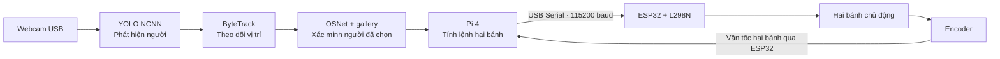

# Human Following Robot V9

**Chọn một người trên ảnh camera. Xe tự căn hướng, bám theo và tìm lại người đó sau khi mất dấu.**

[Thiết bị](#thiết-bị-và-đấu-nối) · [Chạy thử](#chạy-thử) · [Tinh chỉnh](#tinh-chỉnh-trên-terminal)

## Robot hoạt động thế nào?



| Khâu | Cơ sở lý thuyết | Cách dùng trong dự án |
|---|---|---|
| Phát hiện | YOLO dự đoán khung bao và độ tin cậy | Chỉ giữ lớp người. Model NCNN chạy trên Pi. |
| Theo dõi | ByteTrack liên kết khung bao theo thời gian | Tracking ID giúp theo dõi ngắn hạn và có thể đổi sau che khuất. |
| Nhận dạng lại | OSNet biến ảnh cắt người thành vector đặc trưng. Tích vô hướng của hai vector đã chuẩn hóa cho điểm cosine. | Click chọn người để thu gallery đa góc. Khi người xuất hiện lại, so đặc trưng với gallery để xác minh. |
| Khoảng cách | Kích thước biểu kiến thay đổi theo khoảng cách | Dùng chiều rộng khung bao và các mốc đo bằng thước để ước lượng. Góc nhìn và che khuất ảnh hưởng phép đo. |
| Điều khiển | Hai bánh cùng tốc độ để đi thẳng. Chênh tốc độ tạo độ cong. | Khi tiến, giảm ga bánh trong để rẽ. Khi đủ khoảng cách nhưng lệch hướng, xe xoay tại chỗ. Encoder phản hồi vận tốc cho bộ PI trên Pi khi bật bù. |

Ở chế độ bám, Pi dùng độ lệch ngang chuẩn hóa `(tâm người − tâm ảnh) / (chiều rộng ảnh / 2)` để quyết định hướng. Khi mất mục tiêu, lệnh bánh về 0 và hệ thống chờ xác minh lại. Lỗi Serial hoặc encoder có thể hủy ARM.

## Thiết bị và đấu nối

| Thiết bị | Vai trò |
|---|---|
| Raspberry Pi 4, webcam USB và nguồn 5 V phù hợp | Nhận ảnh, chạy nhận diện và tạo lệnh |
| ESP32 DevKit, cáp USB truyền dữ liệu | Nhận lệnh và đọc encoder |
| L298N, hai động cơ DC giảm tốc có encoder | Truyền động vi sai |
| Pin động lực và khung hai bánh | Cấp công suất và lắp ráp robot |
| Thước dây | Đo khoảng cách hiệu chuẩn từ camera đến người |

| Bánh | Kênh L298N | PWM / chân chiều trên ESP32 | Encoder A / B |
|---|---|---|---|
| Trái | B | GPIO25 / GPIO27, GPIO26 | GPIO18 / GPIO19 |
| Phải | A | GPIO13 / GPIO12, GPIO14 | GPIO32 / GPIO35 |

Nối GND ESP32 và L298N. Tháo jumper ENA/ENB để ESP32 cấp PWM. Dùng nguồn động lực riêng cho L298N. Firmware hiện quy đổi encoder theo bánh đường kính **65 mm** và **234 số đếm/vòng**. Đối chiếu số đếm và dấu vận tốc trên xe đã lắp.

## Chạy thử

**1. Chuẩn bị Pi.** Dùng môi trường Python đã chạy được OpenCV có giao diện, Ultralytics, NumPy, PySerial, PyTorch, torchvision và torchreid. Đặt thư mục `yolo26n_ncnn_model/` và checkpoint **OSNet-x0.25 MSMT17** vào `pi/`. Lệnh mẫu dùng model NCNN đã export ở **320 × 320**. Chương trình hỗ trợ `--weights` để chỉ định file checkpoint và `--download-weights` để tải checkpoint được kiểm tra SHA-256.

**2. Thử camera và đăng ký người.** Kích hoạt venv rồi mở terminal trên desktop Pi hoặc qua VNC. Từ thư mục repository, chạy:

```bash
cd pi
python pi4_person_osnet_gallery_motor_v9_tuy_chinh.py \
  --camera 0 --model yolo26n_ncnn_model --imgsz 320 \
  --serial none --reid osnet --flip horizontal
```

Click vào một người trong khung, xoay chậm để thu các góc nhìn và chờ `GALLERY READY`. Cho người rời ảnh rồi quay lại để thử tìm lại đúng người.

**3. Nạp ESP32.** Mở thư mục `esp32/` trong PlatformIO, chọn môi trường `esp32dev`, Build rồi Upload. Đóng Serial Monitor trước khi cắm ESP32 vào Pi. Chọn cổng thực tế, thường là `/dev/ttyUSB0` hoặc `/dev/ttyACM0`.

**4. Chạy bám từ thư mục `pi/`.**

```bash
python pi4_person_osnet_gallery_motor_v9_tuy_chinh.py \
  --camera 0 --model yolo26n_ncnn_model --imgsz 320 \
  --serial /dev/ttyUSB0 --baud 115200 --drive-mode follow \
  --pwm-limit 55 --turn-min 55 --turn-max 55 \
  --forward-min 55 --forward-max 55 --reverse-min 0 --reverse-max 0 \
  --target-distance 1.5 --distance-deadband 0.25 \
  --rotate-first 0.20 --turn-exit 0.10 --arc-delta 5 \
  --encoder-kp 0 --encoder-ki 0 --reid osnet --flip horizontal
```

| Thao tác | Kết quả |
|---|---|
| Click người và đợi `GALLERY READY` | Đăng ký mục tiêu |
| Đứng cách camera 1,5 m, nhấn `2`, đợi `CALIB OK` | Hiệu chuẩn khoảng cách |
| Nhấn `r` | ARM khi có khoảng cách hợp lệ và telemetry encoder |
| Nhấn `s` | Dừng và hủy ARM |
| Nhấn `q` | Thoát |

Kiểm tra chiều quay và dấu encoder khi nhấc bánh khỏi sàn trước lượt chạy dưới đất. Điểm truy cập Wi-Fi trong firmware phục vụ thử nghiệm. Đặt thông tin truy cập riêng trước khi sử dụng trong môi trường dùng chung.

## Tinh chỉnh trên terminal

| Tham số | Tác dụng |
|---|---|
| `--pwm-limit` | Trần PWM gửi đến ESP32. Firmware V9 có trần 120. |
| `--turn-min`, `--turn-max` | Dải PWM đặt khi xoay tại chỗ |
| `--forward-min`, `--forward-max` | Dải ga tiến. Đặt bằng nhau để thử một mức cố định. |
| `--reverse-min`, `--reverse-max` | Ga lùi. Lệnh mẫu đặt cả hai bằng 0. |
| `--arc-delta` | Mức giảm ga tối đa của bánh trong khi rẽ cong |
| `--rotate-first`, `--turn-exit` | Ngưỡng bắt đầu và ngừng xoay. Ngưỡng bắt đầu lớn hơn ngưỡng ngừng. |
| `--target-distance`, `--distance-deadband` | Khoảng cách đặt và vùng giữ khoảng cách, tính bằng mét |
| `--encoder-kp`, `--encoder-ki` | Hệ số bù PI. Lệnh mẫu dùng 0 để thử trực tiếp mức ga. |

Nếu xe hủy ARM, đọc dòng `Motor worker disarmed:` trên terminal để phân biệt lỗi kẹt bánh, dấu encoder, telemetry và Serial.

## Mã nguồn

- `pi/pi4_person_osnet_gallery_no_motor.py` — nhận diện, click chọn người và gallery.
- `pi/pi4_person_osnet_gallery_motor_v9_tuy_chinh.py` — giao diện và luồng USB Serial.
- `pi/ddmr_v9_control_tuy_chinh.py` — luật bám, PI encoder và tăng giảm PWM.
- `esp32/` — firmware PlatformIO và các header.

Model, venv và gallery được đặt riêng trên máy chạy.
